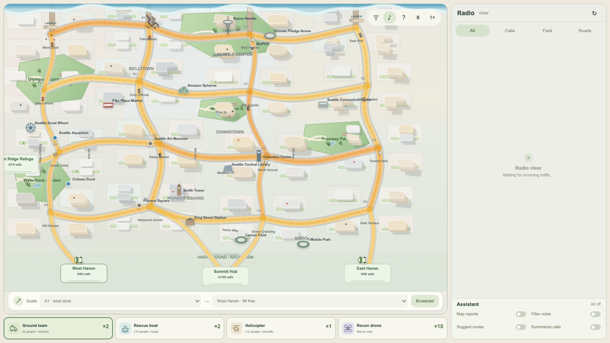
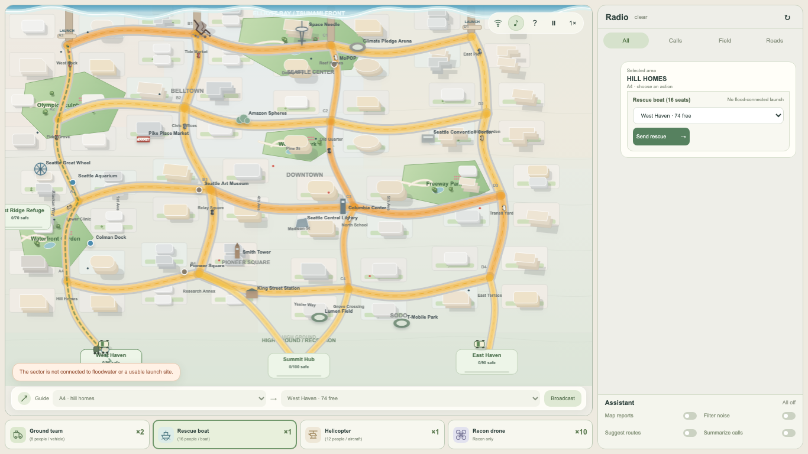
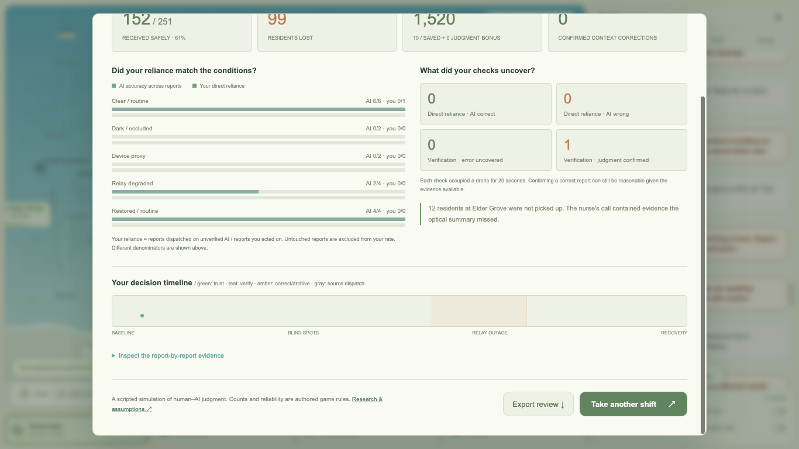

# 🌊 Coastal Command

### AI-Assisted Coastal Emergency Response Simulator

**🏆 3rd Place — Defense Tech Jam Hackathon**  
**48-Hour Hackathon · 6-Person Team · 9 Competing Teams**

> A six-minute, human-in-the-loop coastal evacuation simulator exploring when emergency responders should trust, verify, or override imperfect AI assistance.

<!-- Add your real Vercel deployment URL after deployment. -->
**[Source Code](https://github.com/liuyutongmilla/disaster-watch)** · **Live Demo: Coming Soon**



## Project overview

Coastal Command is an English-language rescue-command prototype about **calibrated trust in AI**. You run a coastal evacuation from a dispatch desk: reports arrive by radio, an assistant offers to fuse, filter, route, and summarize them, and every one of those four functions starts **off**. The assistant's mistakes are **scripted**—this is a deterministic simulation, not a live LLM or a real emergency response system. The central challenge is deciding when to check the assistant before acting.

**Hackathon context:** Built during a 48-hour Defense Tech Jam with a six-person team; the team placed third among nine teams.

### My contribution

Contributed to the information-filtering MVP for emergency reports, focusing on classification by location, urgency, and relevant response department or unit so incoming information could be routed to the right decision-maker. The project and award were team efforts; the features below describe the full application, not solely my individual work.

### Highlights

- **Human-in-the-loop assistance:** Independently enable AI-style report mapping, noise filtering, route suggestions, and call summaries; inspect original evidence and correct mistakes.
- **Operational simulation:** Dispatch ground crews, rescue boats, helicopters, and recon drones through evolving road and flood conditions.
- **Transparent decisions:** Track which reports were verified, which advice was used, and how rescue outcomes changed.
- **Client-side implementation:** JavaScript, HTML, CSS, Canvas rendering, data-driven deterministic simulation, and a dependency-free Node.js static server.

## Screenshots

**Command dashboard** — live map, radio reports, assistant controls, and dispatch categories (shown above).

**Rescue boat deployment** — route and unit operations.



**After-action review** — simulation results and AI reliance analysis.



## Run

```sh
npm start
```

Open **http://localhost:4173**. No install, API key, build, or runtime dependency is required. Node.js 22+ runs the static server; validation uses Node.js 26.8.1. Any static HTTP server also works, including `python3 -m http.server 4173`. Direct `file://` loading is not supported.

For another device on your local network, use `HOST=0.0.0.0 npm start` and open the computer's LAN IP on port 4173.

## Dispatch

The bottom bar contains **four unit categories**, not duplicated individual-unit controls:

| Category | Initially available | Individual capacity | Role |
| --- | ---: | --- | --- |
| Ground team | 2 | 8 residents | Road rescue and clearing road incidents |
| Rescue boat | 2 | 16 residents | Trailer to a launch ramp, then rescue through connected floodwater |
| Helicopter | 1 | 12 residents | Rescue across terrain |
| Recon drone | 10 | Recon only | Verify a report or survey a sector |

**Drag a category onto a map location or an incident** to send one ready unit. Its available count decreases immediately; it returns to the pool after its return trip. An alternative is to select a category, then select a radio report or a map location. Dispatch actions appear inside the expanded report in the Radio panel.

Actual missions always draw dashed routes and moving unit icons. Rescue boats appear on a tow vehicle while travelling on roads, change to a boat at West Dock or East Pier, then follow a blue floodwater route. Optional AI route advice draws a separate suggested route. The selected destination shows estimated outgoing and return times, launch site, and each vehicle's capacity. Hovering a category gives the individual missions and current-leg times; the category also shows deployed units, returning units, and the next returning unit's arrival time.

The reception-hub selector shows free space after reservations. Each rescue dispatch reserves a full vehicle load. A busy unit, insufficient hub space, already-assigned report, or wrong unit type produces a visible reason instead of a silently inactive control. Selecting a road incident requires a ground team.

## Radio and assistance

The application is fixed to the viewport. **Radio** starts clear, then receives the first traffic after a short quiet opening. It uses pale rounded chat bubbles in a separately scrolling panel. Selecting a report expands its evidence, hub choice, correction tools, and available actions in place. Tabs filter Calls, Field, and Roads. When you scroll back, new messages do not pull you away from what you are reading.

- With **Map reports** off, dispatch uses the direct source location. Switching it on adds the assistant's fused markers and assessment, including its scripted mistakes.
- **Filter noise** removes personal chatter and nonessential colleague interruptions, then focuses Radio on the unit category you have selected. Ground teams lose submerged sectors, drones and the airlift keep every report, and rescue boats keep only waterfront sectors, reports whose text is explicitly water-related, and their own boat traffic. Reports with no remaining people are dropped from the boat view.
- **Suggest routes** adds route advice. Your actual dispatched routes remain visible regardless.
- **Summarize calls** replaces the call text with the assistant summary; **Read original call** restores the source for that message.

Edit the selected report's sector or priority, apply the correction, then dispatch. Archive a report you judge empty or duplicated. A drone verifies the report it is sent to: **5 seconds outbound + 15 seconds scanning + 5 seconds return**. Field truth appears after 20 seconds, but that drone is unavailable until it returns.

**Guide walkers** broadcasts a route from the selected sector to the selected reception hub. Trapped residents still need a rescue vehicle. The water keeps moving while inspecting evidence, reading help, or switching browser tabs; a delayed frame catches up all elapsed time. The pause button or `Esc` stops the simulation and covers the command view with a blurred grey pause screen. `1× / 2×` changes simulation speed. `M` toggles sound.

## Road emergencies and colleagues

- **Shore Road collision**, at 38 seconds: blocks B1 ↔ C1; a ground crew needs 12 seconds of work on arrival.
- **Civic Bridge approach washout**, at 155 seconds: blocks B2 ↔ B3; 20 seconds of ground work.
- **School Crossing congestion**, at 214 seconds: adds 8 seconds to affected surface travel until a crew completes 10 seconds of traffic control.

Working crews must return before becoming available again. Unattended closures persist. Boat trailers reroute around road closures. Once launched, boats travel only through contiguous flooded sectors; dry inland sectors require a ground team or airlift.

Mara and Ellis occasionally speak from the left side of the map. Their rounded dialogue bubbles fade after the spoken line ends. Useful local observations mix with low-frequency distractions. Speech uses **browser/OS English text-to-speech**, enabled by the Begin shift gesture, alongside local synthesized radio cues. The music-note control is highlighted while audio is active. Voice availability and pronunciation depend on installed browser/OS voices. If speech is unavailable or muted, the bubble remains for a readable interval and then fades. This is not prerecorded voice acting.

## Review

At six minutes, inspect rescued/lost residents, condition-level AI reliance, verification outcomes, a decision timeline, and the truth behind all 24 reports. Source-only dispatch is recorded separately from reliance on the assistant. Export the review as JSON or replay; replay resets AI controls to off and restores all unit pools.

## Edit and validate

- `data/level.json`: reports, direct sources, AI assessments, hidden truth, units, road incidents, colleague scripts, and noise.
- `src/engine.js`: deterministic simulation, travel, capacity, roads, and scoring.
- `src/map.js`: Canvas town, water, roads, vehicles, hit targets, and routes.
- `src/app.js`: fixed-screen interface, chat, category drag/drop, and interactions.
- `src/audio.js`: synthetic radio audio and browser speech with dialogue lifecycle.
- `src/review.js`: after-action review.

```sh
npm test
npm run check
CHROME_PATH=/path/to/chrome npm run test:browser
```

The browser test requires the local server. It uses Chrome DevTools Protocol without package dependencies and writes screenshots/results to `artifacts/`. Its synthetic speech adapter verifies language, speech invocation, end callbacks, and bubble fading; it does not assess the sound of actual installed voices.

The visual reference is [Mini Motorways' official screenshots](https://store.steampowered.com/app/1127500/Mini_Motorways/): warm off-white terrain, blue water, readable white roadways, simple colored buildings, consistent shadows, and small unobtrusive controls. The game uses original code-drawn assets, not extracted reference assets.

[Design brief](docs/DESIGN-BRIEF.md) · [Research and assumptions](docs/RESEARCH.md) · [Validation record](docs/VALIDATION.md)

Physical iPhone/Android testing and listening on a machine with an installed English voice remain manual checks. Actual learning effectiveness and six-minute difficulty need human playtesting.
